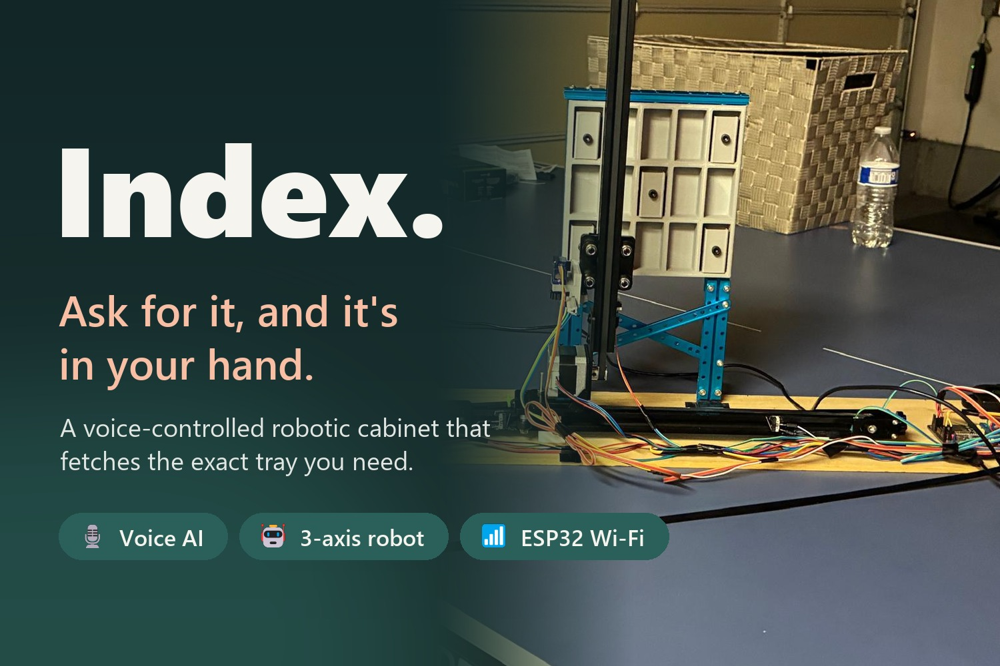
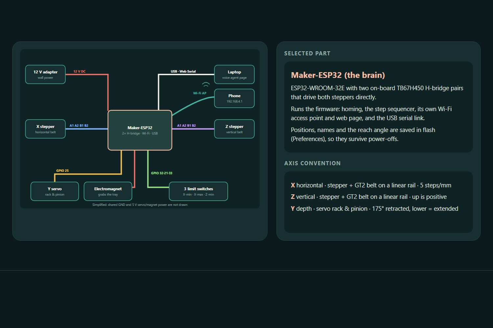
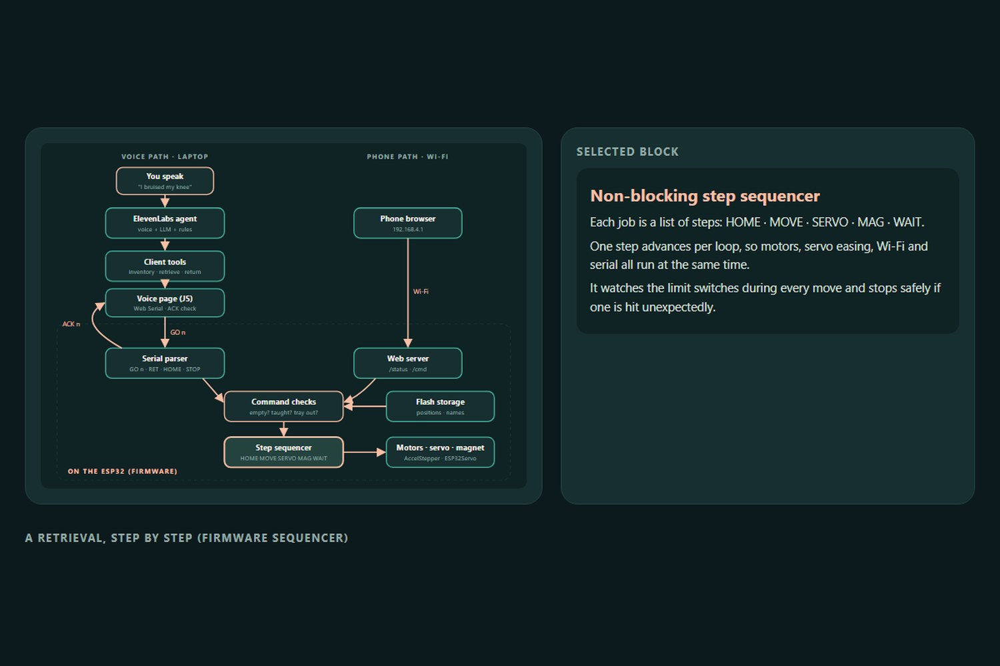

# Index. Ask for it, and it's in your hand.

**Index is a voice-controlled robotic cabinet.** You ask for what you need, by voice or from your phone. A 3-axis robot pulls out the exact tray, brings it to one spot within reach, and puts it back when you're done.

- **Live site (interactive simulator, wiring diagram, software flowchart):** https://index-robot-cabinet.vercel.app
- **Pitch video (5 min):** https://youtu.be/mBE0BZBnR84

## Why
- More than 1 in 4 U.S. adults has a disability, and mobility is the most common type (CDC).
- 1 in 4 adults over 65 falls each year (CDC), often while reaching or climbing.
- About half of people on long-term medication don't take it as prescribed (WHO, 2003).

Storage assumes you can reach, see, search and remember. Labels still make you read. Smart speakers can't hand you anything. Hospital and pharmacy robots cost tens of thousands of dollars. Index brings the same idea to a kitchen, a school nurse's office or a small clinic, for about **$300 in parts**.

## What it does
- **Voice:** "I bruised my knee" → the agent finds *Bandages, compartment 1* and **moves only after you say yes**. It only offers what's in stock and never gives medical advice.
- **Phone:** the ESP32 makes its own Wi-Fi network (`Index`) and serves its own page at `192.168.4.1`, with no app or internet needed. You can search, retrieve, return, rename, and mark compartments empty.
- **Retrieve:** the X and Z belts move the arm to the compartment, the Y rack extends, and an electromagnet grabs the tray's steel washer. The tray is delivered on top of the cabinet.
- **Return:** the tray goes back into its exact compartment. If you ask for something else while a tray is out, Index returns that one first.
- **Verified commands:** the page sends `GO n`, and the robot must answer `ACK n`. A mismatch or a timeout is rejected.

## Hardware
| Part | Details |
|---|---|
| Controller | Maker-ESP32 (ESP32-WROOM-32E) with on-board TB67H450 H-bridges |
| X axis (horizontal) | Stepper + GT2 belt on a linear rail, 5 steps/mm, block A: GPIO 13 · 27 · 4 · 2 |
| Z axis (vertical) | Stepper + GT2 belt on a linear rail, block B: GPIO 17 · 12 · 15 · 14 |
| Y axis (depth) | Servo rack & pinion, GPIO 25 (175° retracted, lower = extended) |
| Gripper | Electromagnet module, GPIO 26 |
| Limit switches | X-min GPIO 32 · X-max GPIO 21 · Z-min GPIO 33 (C → GND, NO → pin, internal pull-up) |
| Cabinet | 15 compartments (3 × 5), 3D-printed trays with steel washers, aluminum frame |
| Power | 12 V wall adapter (5.5 × 2.1 mm, center-positive) |

## Software

- `firmware/index-firmware/`: Arduino C++ for the ESP32.
  - Non-blocking step sequencer (HOME · MOVE · SERVO · MAG · WAIT), so the motors, servo, Wi-Fi and serial link all run at the same time.
  - Homing with debounced limit switches, plus software travel limits.
  - Teach compartments 1, 5 and 11, and it interpolates the other 12. Positions are saved in flash.
  - Return move: go in 3 mm higher → push in → magnet off → slide up 10 mm → retract.
  - Motors release when idle to save power.
- `voice/`: the voice and control page. ElevenLabs conversational agent with client tools `get_inventory`, `retrieve_item(compartment)` and `return_item`, plus a Web Serial link to the ESP32.
- `site/`: the public demo site, deployed on Vercel.

### Serial protocol (115200 baud)
| Send | Reply |
|---|---|
| `GO n` | `ACK n`, or `ERR reason` (e.g. `ERR compartment 10 is still out`) |
| `RET` | `OK`, then later `>>> Compartment n returned.` |
| `HOME` / `STOP` | `OK …` |

## Run it
1. **Firmware.** Arduino IDE with the ESP32 core and the **AccelStepper** and **ESP32Servo** libraries. Open `firmware/index-firmware/index-firmware.ino` and upload it to the board.
2. **Setup.** Join the Wi-Fi `Index` (password `12345678`) and open `http://192.168.4.1` → **Setup**.
   - Press **Home**.
   - Jog to compartments 1, 5 and 11 and **Save** each one, then press **Fill grid**.
   - Save the reach angle and the delivery point.
3. **Voice (optional).** Create an ElevenLabs agent with the three client tools above. Run `voice/start-voice.bat`, or `python -m http.server 5190` in `voice/`. Open it in Chrome, paste your agent ID, click **Connect robot (USB)**, then **Start conversation**.

## Axis convention
X = horizontal · Y = rack depth · Z = vertical

---
Built in November 2026. Also submitted to NorCal Hacks 27 (New Frontiers).
